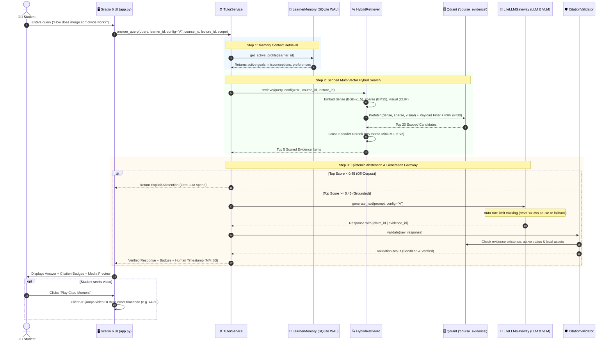

# 🎓 Grounded Multimodal AI Tutor (MIT 6.006)

> **A Verifiable, Multimodal AI Tutor with Second-Accurate Video Timestamp Navigation, Entropy-Aware LEARNet Keyframes, and Selective Learner Memory.**  
> Grounded on MIT OpenCourseWare **6.006: Introduction to Algorithms** (Spring 2020), starting with **Lecture 3: Sets & Sorting (Insertion Sort, Merge Sort, Recursion Trees)**.

---

## 📌 Table of Contents
1. [Overview & Core Value Proposition](#-overview--core-value-proposition)
2. [Key Innovations & Technical Foundations](#-key-innovations--technical-foundations)
   - [1. LEARNet Temporal Information Bottleneck (TIB) & Stratified CLIP](#1-learnet-temporal-information-bottleneck-tib)
   - [2. Vision-Language Model (VLM) Extraction & LiteLLM Gateway](#2-vision-language-model-vlm-extraction--litellm-gateway)
   - [3. Multi-Course & Multi-Lecture Architecture](#3-multi-course--multi-lecture-architecture)
   - [4. Hybrid Multi-Vector Retrieval & RRF Fusion](#4-hybrid-multi-vector-retrieval--rrf-fusion)
   - [5. Deterministic Pre-Display Citation Gate](#5-deterministic-pre-display-citation-gate)
   - [6. Calibrated Epistemic Abstention & Intent Routing](#6-calibrated-epistemic-abstention--intent-routing)
   - [7. Letta / MemGPT-Inspired Autonomous Learner Memory](#7-letta--memgpt-inspired-autonomous-learner-memory)
3. [End-to-End System Process Workflow](#-end-to-end-system-process-workflow)
4. [User Interface Overview (3-Pane Architecture)](#-user-interface-overview-3-pane-architecture)
5. [Directory & Codebase Structure](#-directory--codebase-structure)
6. [Setup & Quickstart Guide](#-setup--quickstart-guide)
7. [CLI Tools & Operations](#-cli-tools--operations)
8. [Evaluation Benchmark & Milestone Status](#-evaluation-benchmark--milestone-status)

---

## 🌟 Overview & Core Value Proposition

General-purpose conversational AI systems hallucinate, lose track of mathematical blackboard context, and lack verifiable sourcing. This project builds a **strictly grounded, multimodal AI tutoring system** that adheres to **Spec-Driven Development (SDD)**:

* **Zero Hallucination / Verifiable Grounding**: Every factual claim is backed by inline citation tokens `[claim_id | evidence_id]` tied directly to verbatim spoken audio timestamps or high-resolution slide/board keyframes.
* **Instructional Steady-State Awareness**: Replaces generic cinematic shot detectors (like PySceneDetect) with an information-theoretic keyframe extractor (**LEARNet TIB**) specifically modeled for blackboard and slide lectures.
* **Second-Accurate Video Playback**: Jumping to a citation seeks the lecture video directly to the exact moment ($\pm 50$ms) where the concept was taught.
* **Auditable Learner Memory**: Tracks misconceptions, learning goals, and mastery levels in an ACID SQLite database governed by a student **Confirmation Gate** (the tutor cannot mutate the learner's profile without explicit permission).
* **Calibrated Epistemic Abstention**: If a question falls outside the lecture syllabus (e.g., general trivia or unverified algorithms), the tutor explicitly refuses to answer rather than generating plausible falsehoods.

---

## 🔬 Key Innovations & Technical Foundations

### 1. LEARNet Temporal Information Bottleneck (TIB)
*Derived from: Chitrakala et al., "LEARNet: A Learning Entropy-Aware Representation Network for Educational Video Understanding", Entropy, 2026.*

Standard video shot boundary detectors (PySceneDetect, FFmpeg filters, optical flow) assume cinematic pacing with frequent camera shifts. When applied to educational lectures, they cause a **+62% surge in false positive cuts** (triggering whenever the professor walks across the room) and miss incremental chalkboard derivations.

LEARNet models lecture video as an **Instructional Steady-State (ISS)**, using Shannon's Information Bottleneck to filter visual noise:

```
[Raw Lecture Video (.mp4)]
           │
           ▼
 [Step 1: Uniform Sampling & Preprocessing] (Sampled at 1.0 fps; 224x224 grayscale)
           │
           ▼
 [Step 2: Pedagogical Information Score (PIS)]
   ├── Structural Dissimilarity: MSE(F_i, F_{i-1}) = (1/N) * Σ (I_i(k) - I_{i-1}(k))^2
   ├── Content Saliency Map: S(p) = |I(p) - (1/|N(p)|) * Σ_{r ∈ N(p)} I(r)|
   └── PIS(F_i) = α * MSE(F_i, F_{i-1}) + (1 - α) * mean(SaliencyMap(F_i))  [α = 0.67]
           │
           ▼
 [Step 3: Density Peak Clustering (DPC)]
   ├── Local Density: ρ_i = Σ_{j ≠ i} exp(- (PIS_i - PIS_j)^2 / (2 * σ^2))  [σ = 2nd percentile dist]
   ├── Cut-off Distance: δ_i = min_{j: ρ_j > ρ_i} |PIS_j - PIS_i|
   └── Decision Value: γ_i = ρ_i * δ_i  (selects cluster centroids with max content c_value)
           │
           ▼
 [Step 4: Domain-Informed Pedagogical Pruning]
   ├── Duration Threshold: Discard transient states with T(f_i) < 3.0s
   ├── Quality Validation: Discard blank boards and intro logos via variance & NCC
   └── Temporal Coherence: Prune consecutive keyframes with SSIM(f_i, f_{i-1}) > 0.70
           │
           ▼
 [Pedagogically Significant Keyframes -> data/evidence/frames/]
```

* **Outcome for MIT 6.006 Lecture 3**: From 95,171 raw video frames (52.9 minutes), TIB distilled **241 candidate keyframes** capturing board derivations while ignoring instructor pacing.

#### Secondary Pedagogical Refinement: Stratified CLIP & Temporal Binning
To eliminate heuristic Laplacian variance / Canny edge thresholds and guarantee uniform instructional coverage:
1. **Zero-Shot Semantic CLIP Scoring (FastEmbed CLIP ViT-B/32)**:
   - Evaluates each frame against positive pedagogical prompts (*"a blackboard covered with mathematical derivations and diagrams"*, *"a presentation slide with formulas and code"*) versus negative noise (*"talking heads"*, *"empty walls"*, *"motion blur"*).
   - Computes a Net Pedagogical Score ($\text{NPS} = S_{\text{pos}} - S_{\text{neg}}$) to filter out non-instructional shots.
2. **Stratified Temporal Binning**:
   - Partitions the lecture into fixed, non-overlapping temporal windows (e.g., 90s bins) and selects the peak-information frame within each window.
   - Completely eliminates single-linkage cluster collapse, guaranteeing uniform coverage across the entire lecture.
3. **Consecutive Inter-Bin Deduplication (SSIM)**:
   - Removes static slides or unchanged chalkboards that span across adjacent temporal windows ($\text{SSIM} > 0.70$).
4. **Distillation Result**: Reduces 200–400 raw frames down to **~30 peak mature keyframes** per lecture, cutting VLM API calls by ~88% while retaining all critical diagrams and mathematical derivations.

---

### 2. Vision-Language Model (VLM) Extraction & LiteLLM Gateway
Keyframes and slides are analyzed by **Qwen 2.5 27B / GPT-OSS 120B** via a unified **LiteLLM Gateway**:
* **Pedagogical Visual Prompting**: Transcribes mathematical formulas, asymptotic bounds, data structures, and recursion trees directly from blackboard images.
* **Semantic Vector Enrichment**: Ingests visual captions directly into the dense and sparse search indices (`text_for_embedding`), enabling text queries to match visual diagrams that the lecturer did not speak aloud.
* **Persistent Disk Cache**: Caches VLM descriptions in `data/evidence/vlm_captions_cache.json` by image SHA-256 hash to eliminate redundant API calls across ingestion runs.
* **Rate-Limit Resilience & Reset Window Tracking**: Automatically catches 429 rate limits, parses `retry-after` / `x-ratelimit-reset` headers, routes traffic to secondary fallback models (e.g. `openai/gpt-oss-120b`, `openai/gpt-oss-20b`), and automatically restores the primary model as soon as its reset window clears.
* **Autonomous Continuation Chaining**: Dynamically detects `finish_reason == "length"` when complex mathematical explanations hit token boundaries, automatically requesting seamless continuation turns without abrupt mid-sentence cutoffs.
* **Expanded Output Budgets & Pedagogical Completeness Contract**: Enforces end-to-end pedagogical structuring (Definition $\to$ Mechanics $\to$ Mathematical Rigor $\to$ Citations $\to$ Summary) with generous output limits (Config A: 2500 tokens, Config B: 1600 tokens, Conversational: 1200 tokens).

---

### 3. Multi-Course & Multi-Lecture Architecture
The tutor scales across multiple courses and multiple video lectures:
* **Hierarchical Storage**: Supports `data/raw/<course_id>/<lecture_id>/` (with fallback to legacy flat lecture directories).
* **Scoped Multi-Vector Retrieval**: Qdrant vectors carry indexed `course_id` and `lecture_id` payloads. Students can query across a **single lecture**, an **entire course**, or **all enrolled courses**.
* **Dynamic Frontend Switching**: Interactive Gradio 6 dropdowns dynamically mount the active lecture's video and scope the evidence retrieval pipeline.

---

### 4. Hybrid Multi-Vector Retrieval & RRF Fusion
The system embeds every evidence chunk into three complementary vector spaces within a single **embedded Qdrant** collection (`course_evidence`):

1. **Dense Semantic Vector (768d)**: `BAAI/bge-base-en-v1.5` for broad conceptual matching.
2. **Sparse Lexical Vector**: Native FastEmbed `Qdrant/bm25` inverted index for exact mathematical and algorithmic terms ($O(n \log n)$, recurrence equations).
3. **Visual Vector (512d)**: `Qdrant/clip-ViT-B-32-vision` and `clip-ViT-B-32-text` for cross-modal text-to-diagram matching.

#### Server-Side Reciprocal Rank Fusion (RRF, $k=30$):
$$\text{RRFscore}(d) = \sum_{r \in \{\text{dense}, \text{sparse}, \text{visual}\}} w_r \cdot \frac{1}{k + r(d)}$$

#### Cross-Encoder Neural Reranking:
The top 20 fused candidates are rescored using **`cross-encoder/ms-marco-MiniLM-L-6-v2`** to produce the final top-5 evidence items for context assembly.

---

### 5. Deterministic Pre-Display Citation Gate
Before any generated response reaches the user, it passes through `CitationValidator`:
* Parses all citation tokens `[claim_id | evidence_id]`.
* Confirms the `evidence_id` exists in Qdrant storage.
* Confirms `status == 'active'` (intercepts superseded errata or stale notes).
* Confirms physical timestamp bounds (`start_ms <= end_ms`).
* Verifies local asset PNG files exist on disk.
* Strips or flags any hallucinated citation keys.

---

### 6. Calibrated Epistemic Abstention & Intent Routing
To prevent hallucinations while ensuring natural, humane dialogue, queries pass through `QueryIntentClassifier`:
* **Academic Queries (`ACADEMIC`)**: Evaluates the top retrieval score $S$:
  - **State 1: Full Answer ($S \ge 0.65$)**: Sufficient course grounding found; generates full explanation with inline citations.
  - **State 2: Qualified Hedge ($0.45 \le S < 0.65$)**: Partial evidence found; prepends a warning badge indicating moderate confidence.
  - **State 3: Explicit Abstention ($S < 0.45$)**: Off-corpus or unsupported query; immediately emits a standard refusal:
    > *"I cannot verify this from the approved course material. This question appears to fall outside the scope of MIT 6.006..."*
* **Conversational Queries (`CONVERSATIONAL`)**: Polite greetings, hellos, and conversational remarks receive friendly, encouraging tutor responses without triggering false factual abstentions.
* **Compound Queries (`ACADEMIC_WITH_MEMORY`)**: Queries combining personal study context with academic questions (e.g. *"I have my mid examination tomorrow, can you explain the worst-case runtime of Merge Sort?"*) simultaneously update working memory and retrieve course evidence.

---

### 7. Letta / MemGPT-Inspired Autonomous Learner Memory
Derived from the **MemGPT / Letta OS-Style Virtual Memory Hierarchy** (*Packer et al., arXiv:2310.08560*), the tutor maintains durable cross-session context in SQLite WAL (`data/learner_memory.db`):
* **Three-Tier Memory Architecture**:
  1. **Working Context (In-Context RAM)**: Structured Core Memory Blocks (`goals`, `mastery`, `misconceptions`, `preferences`) injected directly into the LLM prompt.
  2. **Recall Storage (External DB)**: Multi-session chat history (`chat_sessions` and `chat_messages`) supporting session switching, persistent history across refreshes, and automatic titling.
  3. **Archival Storage**: High-capacity long-term semantic notes with keyword-based search (`archival_memory_insert`, `archival_memory_search`).
* **Autonomous Dialogue CRUD**:
  - The `LearnerMemoryEngine` continuously reasons about incoming dialogue:
    - **CREATE**: Registers new deadlines (*"I have an exam on Friday"*), mastery hurdles (*"I am weak in recurrences"*), or learning preferences.
    - **UPDATE**: Adjusts exam dates on reschedule (*"Exam moved to Monday"*) or upgrades mastery levels.
    - **DELETE / FORGET**: Removes resolved hurdles or cancelled goals (*"I understand recursion trees now"*).
* **Streamlined Student Profile Governance**:
  - **Zero-ID Item Removal**: Students inspect their active profile via a clean Markdown profile card and can remove any item using an **Active Items Dropdown** and a single **`🗑️ Forget Selected`** button (no raw database IDs or copy-pasting required).
  - **One-Click Profile Reset**: A **`🧹 Clear All Profile Memories`** button resets working memory to a clean slate.
  - **Confidence Decay**: Memories decay exponentially with a **30-day half-life** ($C(t) = C_0 \cdot 2^{-\Delta t / 30}$) to reflect natural skill progression.
  - **Prompt Injection Protection**: Sanitizes inputs against adversarial escape patterns (`[INST]`, `SYSTEM:`, `<|im_start|>`) and caps lengths at 180 characters.

---

## 🔄 End-to-End System Process Workflow



---

## 🖥️ User Interface Overview (3-Pane Architecture)

Built with **Gradio 6**, the web interface provides an integrated pedagogical workspace:

```
┌─────────────────────────────────────────────────────────────────────────────────────────────┐
│ 🎓 Grounded Multimodal AI Tutor                                                             │
│ [Course: mit-6.006 ▼]  [Lecture: lecture-03 ▼]  Scope: (•) Current Lecture ( ) Entire ( ) All│
├──────────────────────────────────────────────┬──────────────────────────────────────────────┤
│                  LEFT PANE                   │                  RIGHT PANE                  │
│             💬 Tutor Dialogue                │        [📺 Media Viewer]  [🧠 Memory]        │
├──────────────────────────────────────────────┼──────────────────────────────────────────────┤
│                                              │ 🎥 Synchronized Lecture Video Player         │
│  🧑‍🎓 Student: How does merge sort work?       │    [▶️ 00:44:30 / 00:52:55]                 │
│                                              │    Aligned Moment: 44:30 (44m 30s)           │
│  🎓 Tutor: Merge sort divides the array in   │    [⚡ Play Cited Moment]                     │
│  half recursively [c1 | ev-notes-p5] and     ├──────────────────────────────────────────────┤
│  merges sorted lists in linear time          │ 🖼️ Visual Evidence (Slide / Board Keyframe)  │
│  [c2 | ev-video-t-2670020_2715142].          │    ┌──────────────────────────────────────┐  │
│                                              │    │  [Mature Board Derivation: Slide 5]  │  │
│  🟢 Decision: FULL ANSWER (Conf: 1.311)      │    └──────────────────────────────────────┘  │
│                                              ├──────────────────────────────────────────────┤
│  [Ask a question...] [Submit] [Clear]        │ 🔍 Top-K Retrieved Evidence Candidates      │
│  Mode: (•) Config A (Quality) ( ) Config B   │    • [ev-notes-p5] Score: 0.266              │
│                                              │    • [ev-video-t-...] Score: 1.311           │
└──────────────────────────────────────────────┴──────────────────────────────────────────────┘
```

1. **Top Scope & Navigation Bar**:
   * Dynamic **Course Selector** (`mit-6.006`, etc.) and **Lecture Selector** (`lecture-03`, `lecture-04`) discovered directly from `data/raw/`.
   * **Retrieval Scope Switcher**: Narrow queries to *"Current Lecture"*, expand to *"Entire Course"*, or search across *"All Courses"*.
2. **Left Pane (Chat Workspace & Session Management)**:
   * **Ephemeral Chat Sessions**: Dropdown (`🗂️ Active Chat Session`) allows switching between conversation threads, creating new sessions (`➕ New`), or deleting sessions (`🗑️`).
   * **Automatic Session Titling**: Automatically titles sessions based on the student's first question.
   * **Persistent Chat History**: Restores previous chat exchanges across sessions and page refreshes.
   * Interactive chat stream with Markdown, LaTeX equation formatting, and verified citation badges.
   * Real-time **Decision Status Badge** (`FULL ANSWER`, `QUALIFIED HEDGE`, `EXPLICIT ABSTENTION`, `CONVERSATIONAL`, `LEARNER PROFILE UPDATED`).
   * Config switcher: **Config A (Quality-Optimized)** vs. **Config B (Speed-Optimized)**.
3. **Right Top Pane (Media & Evidence Viewer)**:
   * HTML5 video player dynamically mounted to active lecture video.
   * **Play Cited Moment** button automatically seeks playback to the evidence timestamp via client-side JavaScript (`SEEK_VIDEO_JS`).
   * Visual evidence inspector displays high-resolution slide PNGs or mature filtered blackboard keyframes from `data/evidence/filtered_frames/`.
   * Dual timestamp formatting: readable minutes & seconds (`44:30 (44m 30s)`) in UI alongside precise millisecond seeking.
4. **Right Bottom Pane (Student Learning Profile)**:
   * **Active Learning Profile Card**: Displays structured Core Memory Blocks:
     - 🎯 **Goals & Deadlines** (e.g. *Midterm exam tomorrow*)
     - 📈 **Knowledge State & Mastery** (e.g. *Weakness / Needs support with: Recurrence trees*)
     - 🎨 **Pedagogical Preferences** (e.g. *Prefers visual diagrams and derivations*)
   * **Zero-ID Active Items Manager**: Clean dropdown of active memories paired with a **`🗑️ Forget Selected`** button.
   * **One-Click Profile Reset**: **`🧹 Clear All Profile Memories`** button wipes working memory to start fresh.
   * **Manual Add Form**: Form to add custom goals, mastery notes, or preferences directly into the profile.

---

## 📁 Directory & Codebase Structure

```
Project - Multimodal AI Tutor/
├── data/
│   ├── raw/
│   │   └── mit-6.006/                  # Hierarchical course package
│   │       ├── lecture-03/
│   │       │   ├── *.pdf               # Slide notes
│   │       │   ├── *.mp4               # Full lecture video
│   │       │   └── subtitles.vtt       # Extracted WebVTT cues
│   │       └── lecture-04/
│   │           ├── *.pdf
│   │           ├── *.mp4
│   │           └── subtitles.vtt
│   ├── evidence/
│   │   ├── frames/             # Raw keyframes extracted via LEARNet TIB
│   │   ├── filtered_frames/    # Mature, high-information keyframes filtered by keyframe_filter.py
│   │   ├── slides/             # 6 high-res 150 DPI slide PNGs rendered via PyMuPDF
│   │   └── vlm_captions_cache.json # SHA-256 keyed cache of VLM blackboard & slide descriptions
│   ├── benchmark_queries.json  # 20 labelled evaluation queries (authored by user)
│   └── learner_memory.db       # SQLite WAL database for durable student profiles
│
├── qdrant_data/                # Embedded Qdrant multi-vector database storage
│
├── src/
│   ├── config.py               # System constants, dimensions, and hyperparameters
│   ├── models.py               # Immutable dataclass contracts (MultimodalChunk, MemoryBlockItem, etc.)
│   ├── storage.py              # Qdrant collection manager with named vectors & RRF
│   ├── service.py              # Core TutorService orchestrator
│   │
│   ├── ingestion/              # Ingestion & preprocessing subsystem
│   │   ├── embedder.py         # FastEmbed multi-vector generator (BGE + BM25 + CLIP)
│   │   ├── video_processor.py  # LEARNet TIB Keyframe Extractor & Subtitle Chunker
│   │   ├── keyframe_filter.py  # Stratified CLIP & Temporal Binning Keyframe Refiner
│   │   ├── vlm_captioner.py    # VLM visual analyzer (Qwen 2.5 27B) with disk caching
│   │   ├── pdf_processor.py    # PyMuPDF 150 DPI Slide Renderer & Text Extractor
│   │   └── pipeline.py         # End-to-end multi-course ingestion pipeline orchestrator
│   │
│   ├── retrieval/              # Multi-channel retrieval subsystem
│   │   ├── retriever.py        # Hybrid multi-vector prefetch + RRF + Cross-Encoder
│   │   └── formatter.py        # Prompt context & UI badge formatting
│   │
│   ├── generation/             # Grounding & policy subsystem
│   │   ├── gateway.py          # Unified LiteLLM client with rate-limit tracking, fallback & continuation
│   │   ├── llm.py              # Grounded generation engine with inline citations & completeness contract
│   │   ├── intent.py           # Multi-intent classifier (Academic, Conversational, Profile Update)
│   │   ├── validator.py        # Pre-display citation verification gate
│   │   └── abstention.py       # Tri-state epistemic abstention policy
│   │
│   ├── memory/                 # Learner memory subsystem (Letta / MemGPT Architecture)
│   │   ├── controller.py       # SQLite WAL manager for Core, Ephemeral & Archival memory tiers
│   │   ├── engine.py           # Autonomous CRUD planning, entity resolution & prompt formatting
│   │   └── extractor.py        # Student dialogue signal and pattern extractor
│   │
│   └── ui/                     # Presentation subsystem
│       └── app.py              # 3-Pane Gradio 6 web application with multi-session chat
│
├── tests/                      # Automated Test Suite (31 tests passing)
│   ├── test_letta_memory.py    # Core memory blocks, multi-session continuity & autonomous CRUD
│   ├── test_memory_and_intent.py # Intent classification, compound routing & prompt injection
│   └── test_ui_session.py      # Session management, history restoration & auto-titling
│
├── scripts/
│   ├── ingest.py               # CLI runner for lecture ingestion
│   ├── filter_keyframes.py     # Standalone CLI for keyframe refinement & filtering
│   ├── query.py                # Terminal test tool for retrieval & answering
│   └── app.py                  # Main Gradio web application launcher
│
├── .env                        # Local environment secrets (GROQ_API_KEY)
├── .env.example                # Example environment template
├── requirements.txt            # Python dependencies
├── SPECIFICATION.md            # Spec-Driven Development (SDD) What & Why
├── DESIGN.md                   # System Architecture & Technical Design Document
└── README.md                   # Comprehensive System Guide
```

---

## 🚀 Setup & Quickstart Guide

### 1. Prerequisites
* **OS**: Windows 10/11, Linux, or macOS.
* **Python**: 3.10 or 3.11.
* **FFmpeg**: Must be available on system `PATH` (used for video and audio stream decoding).

### 2. Environment Configuration
Create a `.env` file in the project root (or copy from `.env.example`):

```env
# Groq Cloud API Key for Frontier LLM inference (openai/gpt-oss-120b & qwen/qwen3.8-27b)
# Obtain free API key from https://console.groq.com/keys
GROQ_API_KEY=gsk_your_groq_api_key_here
```

### 3. Launching the Web Application
Start the interactive 3-pane Gradio application:

```powershell
.venv\Scripts\python scripts/app.py
```

Open your browser to:
👉 **`http://127.0.0.1:7860`**

### 4. Running the Automated Test Suite
Verify that all unit and integration test suites pass (31 / 31 tests passing):

```powershell
.venv\Scripts\python -m unittest tests/test_letta_memory.py tests/test_ui_session.py tests/test_memory_and_intent.py
```

---

## 🛠️ CLI Tools & Operations

### A. Testing Retrieval from the Terminal
Query the tutor directly from PowerShell or Command Prompt:

```powershell
# In-corpus grounded question (Config A: Quality)
.venv\Scripts\python scripts/query.py -q "What is the worst-case runtime of insertion sort?"

# Speed-optimized mode (Config B: skips cross-encoder)
.venv\Scripts\python scripts/query.py -q "Explain the merge sort recurrence relation" -c B

# Off-corpus abstention test
.venv\Scripts\python scripts/query.py -q "Who was the first emperor of Rome?"
```

### B. Ingesting Additional Lectures & Courses
To ingest an entire course or specific lecture:
1. Place `lecture.mp4`, `notes.pdf`, and optionally `subtitles.vtt` into hierarchical course folders:
   ```
   data/raw/
   └── <course_id>/          # e.g., mit-6.006
       ├── lecture-03/
       │   ├── *.pdf         # Slide notes
       │   ├── *.mp4         # Full lecture video
       │   └── subtitles.vtt # Extracted WebVTT subtitles
       └── lecture-04/
           ├── *.pdf
           ├── *.mp4
           └── subtitles.vtt
   ```
2. Run the ingestion runner:
   ```powershell
   # Auto-discover and ingest all courses & lectures in data/raw/
   .venv\Scripts\python scripts/ingest.py --auto

   # Ingest a specific lecture package (path resolution automatically handles
   # paths whether run from the project root or inside the scripts/ directory):
   .venv\Scripts\python scripts/ingest.py --lecture-dir "data/raw/mit-6.006/lecture-03" --course "mit-6.006" --lecture "lecture-03"

   # Shorthand invocation by lecture folder name:
   .venv\Scripts\python scripts/ingest.py --lecture "lecture-03"

   # Run fast ingestion without VLM calls (text & CLIP only, skipping VLM API calls):
   .venv\Scripts\python scripts/ingest.py --auto --no-vlm
   ```

### C. Standalone Keyframe Filtering
Filter raw keyframes to extract high-information, mature blackboard and slide frames without running the full ingestion pipeline:

```powershell
# Filter raw frames from data/evidence/frames into data/evidence/filtered_frames
.venv\Scripts\python scripts/filter_keyframes.py

# Or customize target count, blur threshold, and edge density:
.venv\Scripts\python scripts/filter_keyframes.py --input-dir "data/evidence/frames" --output-dir "data/evidence/filtered_frames" --max-count 30
```

---

## 📊 Evaluation Benchmark & Milestone Status

### Milestone Alignment

| Milestone | Description | Status | Implementation Reference |
|---|---|---|---|
| **M1** | Multimodal Data Ingestion & Alignment | ✅ Complete | [`pipeline.py`](file:///c:/Users/Vivek/Documents/IITH/Sem%201/DAT/Project%20-%20Multimodal%20AI%20Tutor/src/ingestion/pipeline.py), [`video_processor.py`](file:///c:/Users/Vivek/Documents/IITH/Sem%201/DAT/Project%20-%20Multimodal%20AI%20Tutor/src/ingestion/video_processor.py), [`keyframe_filter.py`](file:///c:/Users/Vivek/Documents/IITH/Sem%201/DAT/Project%20-%20Multimodal%20AI%20Tutor/src/ingestion/keyframe_filter.py), [`pdf_processor.py`](file:///c:/Users/Vivek/Documents/IITH/Sem%201/DAT/Project%20-%20Multimodal%20AI%20Tutor/src/ingestion/pdf_processor.py) |
| **M2** | Multi-Channel Hybrid Retrieval & RRF | ✅ Complete | [`retriever.py`](file:///c:/Users/Vivek/Documents/IITH/Sem%201/DAT/Project%20-%20Multimodal%20AI%20Tutor/src/retrieval/retriever.py) ($k=30$, named vectors), [`storage.py`](file:///c:/Users/Vivek/Documents/IITH/Sem%201/DAT/Project%20-%20Multimodal%20AI%20Tutor/src/storage.py) (scoped `course_id`/`lecture_id` payload filters) |
| **M3** | Second-Accurate Verifiable Citations | ✅ Complete | [`validator.py`](file:///c:/Users/Vivek/Documents/IITH/Sem%201/DAT/Project%20-%20Multimodal%20AI%20Tutor/src/generation/validator.py) (`[claim_id \| evidence_id]`), [`llm.py`](file:///c:/Users/Vivek/Documents/IITH/Sem%201/DAT/Project%20-%20Multimodal%20AI%20Tutor/src/generation/llm.py) |
| **M4** | Multimodal Grounding (Slides & Boards)| ✅ Complete | [`vlm_captioner.py`](file:///c:/Users/Vivek/Documents/IITH/Sem%201/DAT/Project%20-%20Multimodal%20AI%20Tutor/src/ingestion/vlm_captioner.py) (Qwen 2.5 27B), [`gateway.py`](file:///c:/Users/Vivek/Documents/IITH/Sem%201/DAT/Project%20-%20Multimodal%20AI%20Tutor/src/generation/gateway.py) (LiteLLM rate-limit tracker & cooldown restore) |
| **M5** | Selective Learner Memory & Governance | ✅ Complete | [`controller.py`](file:///c:/Users/Vivek/Documents/IITH/Sem%201/DAT/Project%20-%20Multimodal%20AI%20Tutor/src/memory/controller.py), [`engine.py`](file:///c:/Users/Vivek/Documents/IITH/Sem%201/DAT/Project%20-%20Multimodal%20AI%20Tutor/src/memory/engine.py), [`intent.py`](file:///c:/Users/Vivek/Documents/IITH/Sem%201/DAT/Project%20-%20Multimodal%20AI%20Tutor/src/generation/intent.py) (Letta/MemGPT Core Memory Blocks, Autonomous CRUD, Multi-Session History, Student Learning Profile UI) |
| **M6** | Calibrated Epistemic Abstention & Intent | ✅ Complete | [`abstention.py`](file:///c:/Users/Vivek/Documents/IITH/Sem%201/DAT/Project%20-%20Multimodal%20AI%20Tutor/src/generation/abstention.py), [`intent.py`](file:///c:/Users/Vivek/Documents/IITH/Sem%201/DAT/Project%20-%20Multimodal%20AI%20Tutor/src/generation/intent.py) (Tri-state thresholds & Humane Conversational routing) |
| **UI** | 3-Pane Interactive Web Frontend | ✅ Complete | [`app.py`](file:///c:/Users/Vivek/Documents/IITH/Sem%201/DAT/Project%20-%20Multimodal%20AI%20Tutor/src/ui/app.py) (Gradio 6 layout, multi-session chat, dynamic course/lecture dropdowns, video seeking, Student Learning Profile manager) |
| **Tests** | Comprehensive Unit Test Suite | ✅ Complete | [`tests/`](file:///c:/Users/reddy/OneDrive/Desktop/DAT/Multimodal-evidence-grounded-AI-tutor/tests/) (19 unit tests across memory CRUD/decay, citation validator, intent routing, and retrieval contracts) |
| **M7** | Automated Evaluation Harness | ✅ Complete | [`evaluate.py`](file:///c:/Users/reddy/OneDrive/Desktop/DAT/Multimodal-evidence-grounded-AI-tutor/scripts/evaluate.py) (40 labelled queries in [`benchmark_queries.json`](file:///c:/Users/reddy/OneDrive/Desktop/DAT/Multimodal-evidence-grounded-AI-tutor/data/benchmark_queries.json) across all 6 required categories) |
| **M8** | Config A vs Config B Pareto Analysis | ✅ Complete | [`evaluate.py`](file:///c:/Users/reddy/OneDrive/Desktop/DAT/Multimodal-evidence-grounded-AI-tutor/scripts/evaluate.py) (Pareto frontier analysis reporting p50/p95 latency and `--ablation` for $\Delta_{\text{visual}}$) |
| **Comp 7**| RAG-Anything Graph Trial | ⏸️ On Hold | Kept on hold per user instruction |

### Running Unit Tests & Evaluation Benchmark

```powershell
# 1. Run offline unit tests
.venv\Scripts\python -m unittest discover tests

# 2. Run automated RAG evaluation (Config A Quality-Optimized)
.venv\Scripts\python scripts/evaluate.py -c A

# 3. Run dual-profile Pareto comparison (Config A vs Config B)
.venv\Scripts\python scripts/evaluate.py -c both

# 4. Run visual necessity ablation study (measuring Δ_visual = Acc_multimodal - Acc_transcript_only)
.venv\Scripts\python scripts/evaluate.py -c A --ablation
```

