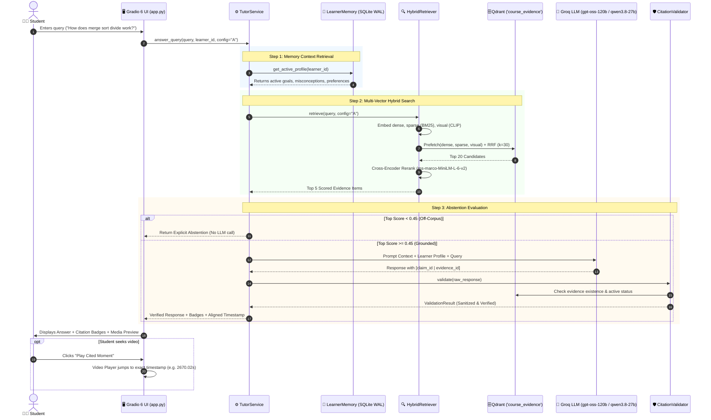

# 🎓 Grounded Multimodal AI Tutor (MIT 6.006)

> **A Verifiable, Multimodal AI Tutor with Second-Accurate Video Timestamp Navigation, Entropy-Aware LEARNet Keyframes, and Selective Learner Memory.**  
> Grounded on MIT OpenCourseWare **6.006: Introduction to Algorithms** (Spring 2020), starting with **Lecture 3: Sets & Sorting (Insertion Sort, Merge Sort, Recursion Trees)**.

---

## 📌 Table of Contents
1. [Overview & Core Value Proposition](#-overview--core-value-proposition)
2. [Key Innovations & Technical Foundations](#-key-innovations--technical-foundations)
   - [LEARNet Temporal Information Bottleneck (TIB)](#1-learnet-temporal-information-bottleneck-tib)
   - [Hybrid Multi-Vector Retrieval & RRF Fusion](#2-hybrid-multi-vector-retrieval--rrf-fusion)
   - [Deterministic Pre-Display Citation Gate](#3-deterministic-pre-display-citation-gate)
   - [Tri-State Epistemic Abstention Policy](#4-tri-state-epistemic-abstention-policy)
   - [Durable Learner Memory with Confirmation Gate](#5-durable-learner-memory-with-confirmation-gate)
3. [End-to-End System Process Workflow](#-end-to-end-system-process-workflow)
4. [User Interface Overview (3-Pane Architecture)](#-user-interface-overview-3-pane-architecture)
5. [Directory & Codebase Structure](#-directory--codebase-structure)
6. [Setup & Quickstart Guide](#-setup--quickstart-guide)
7. [CLI Tools & Operations](#-cli-tools--operations)
8. [Evaluation Benchmark & Milestone Status](#-evaluation-benchmark--milestone-status)

---

## 🌟 Overview & Core Value Proposition

General-purpose conversational AI systems hallucinate, lose track of mathematical blackboard context, and lack verifiable sourcing. This project builds a **strictly grounded, multimodal AI tutoring system** that adheres to **Spec-Driven Development (SDD)**:

* **Zero Hallucination / Verifiable Grounding**: Every factual claim is backed by inline citation tokens `[claim_id | evidence_id]` tied directly to verbatim spoken audio timestamps or high-resolution slide/board keyframes.
* **Instructional Steady-State Awareness**: Replaces generic cinematic shot detectors (like PySceneDetect) with an information-theoretic keyframe extractor (**LEARNet TIB**) specifically modeled for blackboard and slide lectures.
* **Second-Accurate Video Playback**: Jumping to a citation seeks the lecture video directly to the exact moment ($\pm 50$ms) where the concept was taught.
* **Auditable Learner Memory**: Tracks misconceptions, learning goals, and mastery levels in an ACID SQLite database governed by a student **Confirmation Gate** (the tutor cannot mutate the learner's profile without explicit permission).
* **Calibrated Epistemic Abstention**: If a question falls outside the lecture syllabus (e.g., general trivia or unverified algorithms), the tutor explicitly refuses to answer rather than generating plausible falsehoods.

---

## 🔬 Key Innovations & Technical Foundations

### 1. LEARNet Temporal Information Bottleneck (TIB)
*Derived from: Chitrakala et al., "LEARNet: A Learning Entropy-Aware Representation Network for Educational Video Understanding", Entropy, 2026.*

Standard video shot boundary detectors (PySceneDetect, FFmpeg filters, optical flow) assume cinematic pacing with frequent camera shifts. When applied to educational lectures, they cause a **+62% surge in false positive cuts** (triggering whenever the professor walks across the room) and miss incremental chalkboard derivations.

LEARNet models lecture video as an **Instructional Steady-State (ISS)**, using Shannon's Information Bottleneck to filter visual noise:

```
[Raw Lecture Video (.mp4)]
           │
           ▼
 [Step 1: Uniform Sampling & Preprocessing] (Sampled at 1.0 fps; 224x224 grayscale)
           │
           ▼
 [Step 2: Pedagogical Information Score (PIS)]
   ├── Structural Dissimilarity: MSE(F_i, F_{i-1}) = (1/N) * Σ (I_i(k) - I_{i-1}(k))^2
   ├── Content Saliency Map: S(p) = |I(p) - (1/|N(p)|) * Σ_{r ∈ N(p)} I(r)|
   └── PIS(F_i) = α * MSE(F_i, F_{i-1}) + (1 - α) * mean(SaliencyMap(F_i))  [α = 0.67]
           │
           ▼
 [Step 3: Density Peak Clustering (DPC)]
   ├── Local Density: ρ_i = Σ_{j ≠ i} exp(- (PIS_i - PIS_j)^2 / (2 * σ^2))  [σ = 2nd percentile dist]
   ├── Cut-off Distance: δ_i = min_{j: ρ_j > ρ_i} |PIS_j - PIS_i|
   └── Decision Value: γ_i = ρ_i * δ_i  (selects cluster centroids with max content c_value)
           │
           ▼
 [Step 4: Domain-Informed Pedagogical Pruning]
   ├── Duration Threshold: Discard transient states with T(f_i) < 3.0s
   ├── Quality Validation: Discard blank boards and intro logos via variance & NCC
   └── Temporal Coherence: Prune consecutive keyframes with SSIM(f_i, f_{i-1}) > 0.70
           │
           ▼
 [Pedagogically Significant Keyframes -> data/evidence/frames/]
```

* **Outcome for MIT 6.006 Lecture 3**: From 95,171 raw video frames (52.9 minutes), TIB distilled **241 clean, high-resolution keyframes** capturing finished board derivations while ignoring instructor pacing.

---

### 2. Hybrid Multi-Vector Retrieval & RRF Fusion
The system embeds every evidence chunk into three complementary vector spaces within a single **embedded Qdrant** collection (`course_evidence`):

1. **Dense Semantic Vector (768d)**: `BAAI/bge-base-en-v1.5` for broad conceptual matching.
2. **Sparse Lexical Vector**: Native FastEmbed `Qdrant/bm25` inverted index for exact mathematical and algorithmic terms ($O(n \log n)$, recurrence equations).
3. **Visual Vector (512d)**: `Qdrant/clip-ViT-B-32-vision` and `clip-ViT-B-32-text` for cross-modal text-to-diagram matching.

#### Server-Side Reciprocal Rank Fusion (RRF, $k=30$):
$$\text{RRFscore}(d) = \sum_{r \in \{\text{dense}, \text{sparse}, \text{visual}\}} w_r \cdot \frac{1}{k + r(d)}$$

#### Cross-Encoder Neural Reranking:
The top 20 fused candidates are rescored using **`cross-encoder/ms-marco-MiniLM-L-6-v2`** to produce the final top-5 evidence items for context assembly.

---

### 3. Deterministic Pre-Display Citation Gate
Before any generated response reaches the user, it passes through `CitationValidator`:
* Parses all citation tokens `[claim_id | evidence_id]`.
* Confirms the `evidence_id` exists in Qdrant storage.
* Confirms `status == 'active'` (intercepts superseded errata or stale notes).
* Confirms physical timestamp bounds (`start_ms <= end_ms`).
* Verifies local asset PNG files exist on disk.
* Strips or flags any hallucinated citation keys.

---

### 4. Tri-State Epistemic Abstention Policy
To eliminate ungrounded hallucinations, the system evaluates the top retrieval score $S$:
* **State 1: Full Answer ($S \ge 0.65$)**: Sufficient course grounding found; generates full explanation with inline citations.
* **State 2: Qualified Hedge ($0.45 \le S < 0.65$)**: Partial evidence found; prepends a warning badge indicating moderate confidence.
* **State 3: Explicit Abstention ($S < 0.45$)**: Off-corpus or unsupported query; immediately emits a standard refusal:
  > *"I cannot verify this from the approved course material. This question appears to fall outside the scope of MIT 6.006..."*

---

### 5. Durable Learner Memory with Confirmation Gate
Managed by SQLite in Write-Ahead Logging (WAL) mode (`data/learner_memory.db`):
* **Memory Schema**: Tracks `goal`, `mastery`, `misconception`, and `preference`.
* **Confirmation Gate**: Insights inferred by the tutor are marked `tutor_proposed`. They become active only after the student confirms them in the UI (`student_confirmed`).
* **Confidence Decay**: Memories decay exponentially with a **30-day half-life** ($C(t) = C_0 \cdot 2^{-\Delta t / 30}$) to reflect natural skill evolution.
* **Prompt Injection Protection**: Sanitizes inputs against adversarial escape patterns (`[INST]`, `SYSTEM:`, `<|im_start|>`) and caps lengths at 180 characters.

---

## 🔄 End-to-End System Process Workflow



---

## 🖥️ User Interface Overview (3-Pane Architecture)

Built with **Gradio 6**, the web interface provides an integrated pedagogical workspace:

```
┌──────────────────────────────────────────────┬──────────────────────────────────────────────┐
│                  LEFT PANE                   │                  RIGHT PANE                  │
│             💬 Tutor Dialogue                │        [📺 Media Viewer]  [🧠 Memory]        │
├──────────────────────────────────────────────┼──────────────────────────────────────────────┤
│                                              │ 🎥 Synchronized Lecture Video Player         │
│  🧑‍🎓 Student: How does merge sort work?       │    [▶️ 00:44:30 / 00:52:55]                 │
│                                              │    Aligned Timestamp: 2670.02s               │
│  🎓 Tutor: Merge sort divides the array in   │    [⚡ Play Cited Moment]                     │
│  half recursively [c1 | ev-notes-p5] and     ├──────────────────────────────────────────────┤
│  merges sorted lists in linear time          │ 🖼️ Visual Evidence (Slide / Board Keyframe)  │
│  [c2 | ev-video-t-2670020_2715142].          │    ┌──────────────────────────────────────┐  │
│                                              │    │  [Slide 5: Merge Sort Algorithm]     │  │
│  🟢 Decision: FULL ANSWER (Conf: 1.311)      │    └──────────────────────────────────────┘  │
│                                              ├──────────────────────────────────────────────┤
│  [Ask a question...] [Submit] [Clear]        │ 🔍 Top-K Retrieved Evidence Candidates      │
│  Mode: (•) Config A (Quality) ( ) Config B   │    • [ev-notes-p5] Score: 0.266              │
│                                              │    • [ev-video-t-...] Score: 1.311           │
└──────────────────────────────────────────────┴──────────────────────────────────────────────┘
```

1. **Left Pane (Chat Workspace)**:
   * Interactive chat stream with Markdown and LaTeX equation rendering.
   * Real-time **Decision Status Badge** (`FULL ANSWER`, `QUALIFIED HEDGE`, `EXPLICIT ABSTENTION`).
   * Config switcher: **Config A (Quality-Optimized)** vs. **Config B (Speed-Optimized)**.
2. **Right Top Pane (Media & Evidence Viewer)**:
   * HTML5 video player preloaded with Lecture 3.
   * **Play Cited Moment** button automatically seeks playback to the evidence timestamp.
   * Visual evidence inspector displays high-resolution slide PNGs or LEARNet blackboard keyframes.
3. **Right Bottom Pane (Learner Memory Governance)**:
   * Interactive table displaying active student profile attributes.
   * Form to manually add, edit, or delete memory records.

---

## 📁 Directory & Codebase Structure

```
Project - Multimodal AI Tutor/
├── data/
│   ├── raw/
│   │   └── lecture-03/
│   │       ├── 6d1ae5278d02bbecb5c4428928b24194_MIT6_006S20_lec3.pdf  # Slide notes
│   │       ├── MIT6_006S20_02_11_Lecture_3_300k.mp4                  # Full lecture video
│   │       └── subtitles.vtt                                         # Extracted WebVTT cues
│   ├── evidence/
│   │   ├── frames/             # 241 high-res keyframes extracted via LEARNet TIB
│   │   └── slides/             # 6 high-res 150 DPI slide PNGs rendered via PyMuPDF
│   ├── benchmark_queries.json  # 20 labelled evaluation queries (authored by user)
│   └── learner_memory.db       # SQLite WAL database for durable student profiles
│
├── qdrant_data/                # Embedded Qdrant multi-vector database storage
│
├── src/
│   ├── config.py               # System constants, dimensions, and hyperparameters
│   ├── models.py               # Immutable dataclass contracts (MultimodalChunk, etc.)
│   ├── storage.py              # Qdrant collection manager with named vectors & RRF
│   ├── service.py              # Core TutorService orchestrator
│   │
│   ├── ingestion/              # Ingestion & preprocessing subsystem
│   │   ├── embedder.py         # FastEmbed multi-vector generator (BGE + BM25 + CLIP)
│   │   ├── video_processor.py  # LEARNet TIB Keyframe Extractor & Subtitle Chunker
│   │   ├── pdf_processor.py    # PyMuPDF 150 DPI Slide Renderer & Text Extractor
│   │   └── pipeline.py         # End-to-end ingestion pipeline orchestrator
│   │
│   ├── retrieval/              # Multi-channel retrieval subsystem
│   │   ├── retriever.py        # Hybrid multi-vector prefetch + RRF + Cross-Encoder
│   │   └── formatter.py        # Prompt context & UI badge formatting
│   │
│   ├── generation/             # Grounding & policy subsystem
│   │   ├── llm.py              # Groq API client (gpt-oss-120b / qwen3.8-27b)
│   │   ├── validator.py        # Pre-display citation verification gate
│   │   └── abstention.py       # Tri-state epistemic abstention policy
│   │
│   ├── memory/                 # Learner memory subsystem
│   │   └── controller.py       # SQLite WAL manager with Confirmation Gate & CRUD
│   │
│   └── ui/                     # Presentation subsystem
│       └── app.py              # 3-Pane Gradio 6 web application
│
├── scripts/
│   ├── ingest.py               # CLI runner for lecture ingestion
│   ├── query.py                # Terminal test tool for retrieval & answering
│   └── app.py                  # Main Gradio web application launcher
│
├── .env                        # Local environment secrets (GROQ_API_KEY)
├── .env.example                # Example environment template
├── requirements.txt            # Python dependencies
├── SPECIFICATION.md            # Spec-Driven Development (SDD) What & Why
├── DESIGN.md                   # System Architecture & Technical Design Document
└── README.md                   # Comprehensive System Guide
```

---

## 🚀 Setup & Quickstart Guide

### 1. Prerequisites
* **OS**: Windows 10/11, Linux, or macOS.
* **Python**: 3.10 or 3.11.
* **FFmpeg**: Must be available on system `PATH` (used for video and audio stream decoding).

### 2. Environment Configuration
Create a `.env` file in the project root (or copy from `.env.example`):

```env
# Groq Cloud API Key for Frontier LLM inference (openai/gpt-oss-120b & qwen/qwen3.8-27b)
# Obtain free API key from https://console.groq.com/keys
GROQ_API_KEY=gsk_your_groq_api_key_here
```

### 3. Launching the Web Application
Start the interactive 3-pane Gradio application:

```powershell
.venv\Scripts\python scripts/app.py
```

Open your browser to:
👉 **`http://127.0.0.1:7860`**

---

## 🛠️ CLI Tools & Operations

### A. Testing Retrieval from the Terminal
Query the tutor directly from PowerShell or Command Prompt:

```powershell
# In-corpus grounded question (Config A: Quality)
.venv\Scripts\python scripts/query.py -q "What is the worst-case runtime of insertion sort?"

# Speed-optimized mode (Config B: skips cross-encoder)
.venv\Scripts\python scripts/query.py -q "Explain the merge sort recurrence relation" -c B

# Off-corpus abstention test
.venv\Scripts\python scripts/query.py -q "Who was the first emperor of Rome?"
```

### B. Ingesting Additional Lectures
To ingest another lecture (e.g., `data/raw/lecture-04`):
1. Place `lecture.mp4` and `notes.pdf` into `data/raw/lecture-04/`.
2. Run the ingestion runner:
   ```powershell
   .venv\Scripts\python scripts/ingest.py --lecture-dir "data/raw/lecture-04"
   ```
   Or auto-scan all folders:
   ```powershell
   .venv\Scripts\python scripts/ingest.py --auto
   ```

---

## 📊 Evaluation Benchmark & Milestone Status

### Milestone Alignment

| Milestone | Description | Status | Implementation Reference |
|---|---|---|---|
| **M1** | Multimodal Data Ingestion & Alignment | ✅ Complete | [`video_processor.py`](file:///c:/Users/Vivek/Documents/IITH/Sem%201/DAT/Project%20-%20Multimodal%20AI%20Tutor/src/ingestion/video_processor.py), [`pdf_processor.py`](file:///c:/Users/Vivek/Documents/IITH/Sem%201/DAT/Project%20-%20Multimodal%20AI%20Tutor/src/ingestion/pdf_processor.py) |
| **M2** | Multi-Channel Hybrid Retrieval & RRF | ✅ Complete | [`retriever.py`](file:///c:/Users/Vivek/Documents/IITH/Sem%201/DAT/Project%20-%20Multimodal%20AI%20Tutor/src/retrieval/retriever.py) ($k=30$, named vectors) |
| **M3** | Second-Accurate Verifiable Citations | ✅ Complete | [`validator.py`](file:///c:/Users/Vivek/Documents/IITH/Sem%201/DAT/Project%20-%20Multimodal%20AI%20Tutor/src/generation/validator.py) (`[claim_id \| evidence_id]`) |
| **M4** | Multimodal Grounding (Slides & Boards)| ✅ Complete | PyMuPDF slides + LEARNet TIB keyframes |
| **M5** | Selective Learner Memory & Governance | ✅ Complete | [`controller.py`](file:///c:/Users/Vivek/Documents/IITH/Sem%201/DAT/Project%20-%20Multimodal%20AI%20Tutor/src/memory/controller.py) (Confirmation Gate, CRUD) |
| **M6** | Calibrated Epistemic Abstention | ✅ Complete | [`abstention.py`](file:///c:/Users/Vivek/Documents/IITH/Sem%201/DAT/Project%20-%20Multimodal%20AI%20Tutor/src/generation/abstention.py) (Tri-state thresholds) |
| **UI** | 3-Pane Interactive Web Frontend | ✅ Complete | [`app.py`](file:///c:/Users/Vivek/Documents/IITH/Sem%201/DAT/Project%20-%20Multimodal%20AI%20Tutor/src/ui/app.py) (Gradio 6 layout) |
| **M7** | Automated Evaluation Harness | ⏸️ On Hold | Awaiting user's `data/benchmark_queries.json` |
| **M8** | Config A vs Config B Pareto Analysis | ⏸️ On Hold | Prepared in Component 12; awaiting query dataset |
| **Comp 7**| RAG-Anything Graph Trial | ⏸️ On Hold | Kept on hold per user instruction |

### Authoring the 20 Evaluation Benchmark Queries
The evaluation harness requires 20 labelled prospective queries authored in `data/benchmark_queries.json`:
* **5 Text-Only Retrieval**
* **5 Visual-Required Cases** ($\Delta_{\text{visual}} \ge 0.40$)
* **3 Multi-Context Reasoning**
* **3 Off-Corpus Abstention**
* **2 Stale-Source Invalidation**
* **2 Adversarial Prompt Injection**

*(See Section 6.1 in [DESIGN.md](file:///c:/Users/Vivek/Documents/IITH/Sem%201/DAT/Project%20-%20Multimodal%20AI%20Tutor/DESIGN.md#L403-L430) for schema details and worked examples).*

