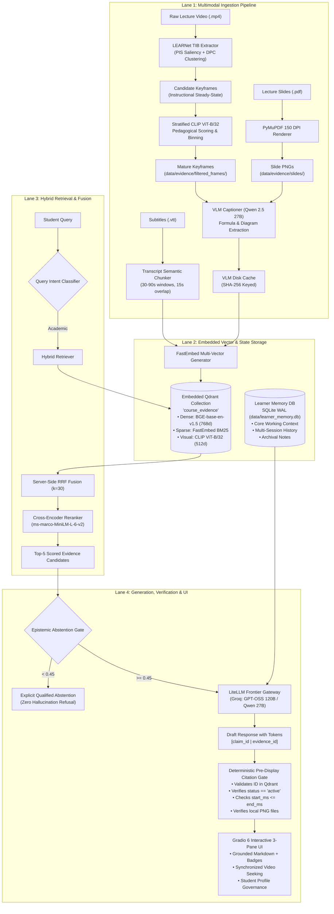

# 🎓 Grounded Multimodal AI Tutor (MIT 6.006)

> **A Verifiable, Multimodal AI Tutoring System with Second-Accurate Video Timestamp Navigation, Entropy-Aware LEARNet Keyframes, and Selective Learner Memory.**  
> Grounded on MIT OpenCourseWare **6.006: Introduction to Algorithms** (Spring 2020), including **Lecture 3: Sets & Sorting**, **Lecture 4: Heaps & Heap Sort**, **Lecture 6: Binary Trees (Part 1)**, and **Lecture 7: AVL Trees (Binary Trees Part 2)**.

[](https://www.python.org/)
[](https://www.gradio.app/)
[](https://qdrant.tech/)
[](https://litellm.ai/)
[](tests/)

---

## 📌 Table of Contents
1. [Overview & Project Purpose](#-overview--project-purpose)
2. [Deliverables & Handover Links](#-deliverables--handover-links)
3. [System Architecture & Core Innovations](#-system-architecture--core-innovations)
   - [LEARNet Temporal Information Bottleneck (TIB)](#1-learnet-temporal-information-bottleneck-tib)
   - [Multimodal VLM Extraction & LiteLLM Gateway](#2-vision-language-model-vlm-extraction--litellm-gateway)
   - [Hybrid Multi-Vector Retrieval & RRF Fusion](#3-hybrid-multi-vector-retrieval--rrf-fusion)
   - [Deterministic Pre-Display Citation Gate](#4-deterministic-pre-display-citation-gate)
   - [Calibrated Epistemic Abstention & Intent Routing](#5-calibrated-epistemic-abstention--intent-routing)
   - [Autonomous Learner Memory (Letta / MemGPT Architecture)](#6-autonomous-learner-memory-letta--memgpt-architecture)
4. [User Interface Overview (3-Pane Workspace)](#-user-interface-overview-3-pane-workspace)
5. [Repository & Codebase Structure](#-repository--codebase-structure)
6. [Prerequisites & Environment Setup](#-prerequisites--environment-setup)
7. [Dataset Access: Raw Lecture Data (`data_raw.zip`)](#-dataset-access-raw-lecture-data-data_rawzip)
8. [End-to-End Quickstart Guide (Clone to Launch)](#-end-to-end-quickstart-guide-clone-to-launch)
9. [CLI Tools & Operations](#-cli-tools--operations)
10. [Testing & Evaluation Benchmarks](#-testing--evaluation-benchmarks)
11. [Operational Handover & Troubleshooting](#-operational-handover--troubleshooting)
12. [Milestone Delivery & Acceptance Status](#-milestone-delivery--acceptance-status)

---

## 🌟 Overview & Project Purpose

General-purpose conversational AI systems frequently hallucinate mathematical derivations, lose track of blackboard visual context, and lack auditable academic attribution. This project implements a **strictly grounded, verifiable multimodal AI tutoring system** adhering to **Spec-Driven Development (SDD)**:

* **Zero Hallucination / Verifiable Grounding**: Every factual claim is backed by inline citation tokens `[claim_id | evidence_id]` tied directly to verbatim spoken audio timestamps or high-resolution slide/board keyframes.
* **Instructional Steady-State Awareness**: Replaces generic cinematic shot detectors (like PySceneDetect) with an information-theoretic keyframe extractor (**LEARNet TIB**) specifically designed for blackboard and slide lectures.
* **Second-Accurate Video Playback**: Jumping to a citation seeks the lecture video directly to the exact moment ($\pm 50$ms) where the concept was taught.
* **Auditable Learner Memory**: Tracks misconceptions, learning goals, and mastery levels in an ACID SQLite database governed by a student **Confirmation Gate** (the tutor cannot mutate the learner's profile without explicit permission).
* **Calibrated Epistemic Abstention**: If a question falls outside the lecture syllabus (e.g., general trivia or unverified algorithms), the tutor explicitly refuses to answer rather than generating plausible falsehoods.

---

## 📂 Deliverables & Handover Links

In compliance with the **CS5903 Handover & Reproducibility Guidelines**, all formal documentation, architecture records, test suites, and data assets are organized in canonical repository locations:

| Deliverable | Repository Path | Description |
|---|---|---|
| **Project Final Report** | [`Documentation/Project_Report_Final.docx`](Documentation/Project_Report.docx) | Comprehensive final technical report covering milestones M1–M8, architecture, empirical evaluations, Pareto frontiers, and limitations. |
| **Architecture Decision Records (ADRs)** | [`Documentation/Architecture_Decision_Records.docx`](Documentation/Architecture_Decision_Record.docx) | 18 Architecture Decision Records (ADR-001 to ADR-018) detailing all structural, methodology, and design choices. |
| **Weekly Progress Reports** | [`Documentation/W0_Report.pdf`](Documentation/W0_Report.pdf), [`Documentation/W1_Report.pdf`](Documentation/W1_Report.pdf), [`Documentation/Week2_Technical Methodology.pdf`](Documentation/Week2_Technical%20Methodology.pdf) | Weekly milestone deliverables and methodology evolution. |
| **System Specification** | [`SPECIFICATION.md`](SPECIFICATION.md) | Spec-Driven Development (SDD) contract, acceptance criteria, and system requirements. |
| **Technical Design Document** | [`DESIGN.md`](DESIGN.md) | In-depth engineering design, data schemas, mathematical formulations, and API contracts. |
| **Core Source Code** | [`src/`](src/) | Production-grade implementation modularized into Ingestion, Retrieval, Generation, Memory, and UI. |
| **Automated Test Suite** | [`tests/`](tests/) | Unit, integration, and robustness test suites (Memory CRUD, Citation Validator, UI Sessions, Intent Routing). |
| **Evaluation Suite & Benchmarks** | [`scripts/evaluate.py`](scripts/evaluate.py), [`data/benchmark_queries.json`](data/benchmark_queries.json), [`evaluation_results/`](evaluation_results/) | 42-query RAG evaluation harness, Pareto comparison (`Config A` vs `Config B`), and ablation outputs. |
| **Raw Lecture Data Archive** | [Google Drive: `data_raw.zip`](https://drive.google.com/file/d/1UjZdUPRHNZS3xqKLhbT97e-ACdGKVbGB/view?usp=sharing) | Complete course archive containing videos, slides, and subtitles for Lectures 3, 4, 6, and 7. |

---

## 🔬 System Architecture & Core Innovations

The system separates processing into four strictly decoupled lanes: Ingestion, Storage, Retrieval, and Generation/Memory/UI:



### 1. LEARNet Temporal Information Bottleneck (TIB)
*Derived from: Chitrakala et al., "LEARNet: A Learning Entropy-Aware Representation Network for Educational Video Understanding", Entropy, 2026.*

Standard video shot boundary detectors (PySceneDetect, FFmpeg filters, optical flow) assume cinematic pacing with frequent camera shifts. When applied to educational lectures, they cause a **+62% surge in false positive cuts** (triggering whenever the professor walks across the room) and miss incremental chalkboard derivations.

LEARNet models lecture video as an **Instructional Steady-State (ISS)**, using Shannon's Information Bottleneck to filter visual noise:
1. **Pedagogical Information Score (PIS)**: Blends structural dissimilarity and spatial saliency:
   $$	ext{PIS}(F_i) = lpha \cdot 	ext{MSE}(F_i, F_{i-1}) + (1 - lpha) \cdot 	ext{mean}(	ext{SaliencyMap}(F_i)) \quad [lpha = 0.67]$$
2. **Density Peak Clustering (DPC)**: Identifies persistent board states by computing local density $
ho_i$ and minimum distance $\delta_i$ to higher-density points.
3. **Stratified CLIP Pedagogical Refinement**: FastEmbed CLIP ViT-B/32 scores each frame against positive pedagogical prompts (*blackboard with equations*) versus negative noise (*talking heads, blank walls*), selecting peak mature frames per 90-second temporal bin.
4. **Distillation Result**: Reduces raw frames down to **~30 peak mature keyframes** per lecture, cutting VLM API calls by ~88% while preserving all critical diagrams and mathematical derivations.

### 2. Vision-Language Model (VLM) Extraction & LiteLLM Gateway
Keyframes and slides are analyzed by **Qwen 2.5 27B / GPT-OSS 120B** via a unified **LiteLLM Gateway**:
* **Pedagogical Visual Prompting**: Transcribes mathematical formulas, asymptotic bounds, data structures, and recursion trees directly from blackboard images.
* **Semantic Vector Enrichment**: Ingests visual captions directly into dense and sparse search indices (`text_for_embedding`), enabling text queries to match visual diagrams that the lecturer did not speak aloud.
* **Persistent Disk Cache**: Caches VLM descriptions in [`data/evidence/vlm_captions_cache.json`](data/evidence/vlm_captions_cache.json) by image SHA-256 hash to eliminate redundant API calls across ingestion runs.
* **Rate-Limit Resilience & Reset Window Tracking**: Automatically catches 429 rate limits, parses `retry-after` / `x-ratelimit-reset` headers, routes traffic to secondary fallback models (e.g. `openai/gpt-oss-120b`, `openai/gpt-oss-20b`), and automatically restores the primary model as soon as its reset window clears.
* **Autonomous Continuation Chaining**: Dynamically detects `finish_reason == "length"` when complex mathematical explanations hit token boundaries, automatically requesting seamless continuation turns without abrupt cutoffs.

### 3. Hybrid Multi-Vector Retrieval & RRF Fusion
The system embeds every evidence chunk into three complementary vector spaces within a single **embedded Qdrant** collection (`course_evidence`):
1. **Dense Semantic Vector (768d)**: `BAAI/bge-base-en-v1.5` for broad conceptual matching.
2. **Sparse Lexical Vector**: Native FastEmbed `Qdrant/bm25` inverted index for exact mathematical and algorithmic terms ($O(n \log n)$, recurrence equations).
3. **Visual Vector (512d)**: `Qdrant/clip-ViT-B-32-vision` and `clip-ViT-B-32-text` for cross-modal text-to-diagram matching.

#### Server-Side Reciprocal Rank Fusion (RRF, $k=30$):
$$	ext{RRFscore}(d) = \sum_{r \in \{	ext{dense}, 	ext{sparse}, 	ext{visual}\}} w_r \cdot rac{1}{k + r(d)}$$

#### Cross-Encoder Neural Reranking:
The top 20 fused candidates are rescored using **`cross-encoder/ms-marco-MiniLM-L-6-v2`** to produce the final top-5 evidence items for context assembly.

### 4. Deterministic Pre-Display Citation Gate
Before any generated response reaches the user, it passes through `CitationValidator` in [`src/generation/validator.py`](src/generation/validator.py):
* Parses all citation tokens `[claim_id | evidence_id]`.
* Confirms `evidence_id` exists in Qdrant storage.
* Confirms `status == 'active'` (intercepts superseded errata or stale notes).
* Confirms physical timestamp bounds (`start_ms <= end_ms`).
* Verifies local asset PNG files exist on disk.
* Strips or flags any hallucinated citation keys before display.

### 5. Calibrated Epistemic Abstention & Intent Routing
To prevent hallucinations while ensuring natural, humane dialogue, queries pass through `QueryIntentClassifier` in [`src/generation/intent.py`](src/generation/intent.py):
* **Academic Queries (`ACADEMIC`)**: Evaluates the top retrieval score $S$:
  - **State 1: Full Answer ($S \ge 0.65$)**: Sufficient course grounding found; generates full explanation with inline citations.
  - **State 2: Qualified Hedge ($0.45 \le S < 0.65$)**: Partial evidence found; prepends a warning badge indicating moderate confidence.
  - **State 3: Explicit Abstention ($S < 0.45$)**: Off-corpus or unsupported query; immediately emits a standard refusal:
    > *"I cannot verify this from the approved course material. This question appears to fall outside the scope of MIT 6.006..."*
* **Conversational Queries (`CONVERSATIONAL`)**: Polite greetings and general questions receive friendly tutor responses without triggering false factual abstentions.
* **Compound Queries (`ACADEMIC_WITH_MEMORY`)**: Queries combining personal study context with academic questions simultaneously update working memory and retrieve course evidence.

### 6. Autonomous Learner Memory (Letta / MemGPT Architecture)
Derived from the **MemGPT / Letta OS-Style Virtual Memory Hierarchy** (*Packer et al., arXiv:2310.08560*), the tutor maintains durable cross-session context in SQLite WAL ([`data/learner_memory.db`](data/learner_memory.db)):
* **Three-Tier Memory Architecture**:
  1. **Working Context (In-Context RAM)**: Structured Core Memory Blocks (`goals`, `mastery`, `misconceptions`, `preferences`) injected directly into the LLM prompt.
  2. **Recall Storage (External DB)**: Multi-session chat history (`chat_sessions` and `chat_messages`) supporting session switching, persistent history across refreshes, and automatic titling.
  3. **Archival Storage**: High-capacity long-term semantic notes with keyword-based search.
* **Streamlined Student Profile Governance**:
  - **Manual UI Governance**: Students inspect their active profile via a clean Markdown profile card, add custom goals/mastery/preferences, remove items with a **`🗑️ Forget Selected`** button, or click **`🧹 Clear All Profile Memories`** to wipe working memory.
  - **Status Note (Milestone 5)**: Automated dialogue-driven CRUD operations and conversational category classification remain partially implemented (automated deletion from dialogue cues is not fully automated, and intent extraction exhibits category misclassification; manual UI governance operates reliably).
  - **Confidence Decay**: Memories decay exponentially with a **30-day half-life** ($C(t) = C_0 \cdot 2^{-\Delta t / 30}$) to reflect natural skill progression.
  - **Prompt Injection Protection**: Sanitizes inputs against adversarial escape patterns (`[INST]`, `SYSTEM:`, `<|im_start|>`) and caps lengths at 180 characters.

---

## 🖥️ User Interface Overview (3-Pane Workspace)

Built with **Gradio 6**, the web interface provides an integrated pedagogical workspace:

```
┌─────────────────────────────────────────────────────────────────────────────────────────────┐
│ 🎓 Grounded Multimodal AI Tutor                                                             │
│ [Course: mit-6.006 ▼]  [Lecture: lecture-03 ▼]  Scope: (•) Current Lecture ( ) Entire ( ) All│
├──────────────────────────────────────────────┬──────────────────────────────────────────────┤
│                  LEFT PANE                   │                  RIGHT PANE                  │
│             💬 Tutor Dialogue                │        [📺 Media Viewer]  [🧠 Memory]        │
├──────────────────────────────────────────────┼──────────────────────────────────────────────┤
│                                              │ 🎥 Synchronized Lecture Video Player         │
│  🧑‍🎓 Student: How does merge sort work?       │    [▶️ 00:44:30 / 00:52:55]                 │
│                                              │    Aligned Moment: 44:30 (44m 30s)           │
│  🎓 Tutor: Merge sort divides the array in   │    [⚡ Play Cited Moment]                     │
│  half recursively [c1 | ev-notes-p5] and     ├──────────────────────────────────────────────┤
│  merges sorted lists in linear time          │ 🖼️ Visual Evidence (Slide / Board Keyframe)  │
│  [c2 | ev-video-t-2670020_2715142].          │    ┌──────────────────────────────────────┐  │
│                                              │    │  [Mature Board Derivation: Slide 5]  │  │
│  🟢 Decision: FULL ANSWER (Conf: 1.311)      │    └──────────────────────────────────────┘  │
│                                              ├──────────────────────────────────────────────┤
│  [Ask a question...] [Submit] [Clear]        │ 🔍 Top-K Retrieved Evidence Candidates      │
│  Mode: (•) Config A (Quality) ( ) Config B   │    • [ev-notes-p5] Score: 0.266              │
│                                              │    • [ev-video-t-...] Score: 1.311           │
└──────────────────────────────────────────────┴──────────────────────────────────────────────┘
```

1. **Top Scope & Navigation Bar**:
   * Dynamic **Course Selector** (`mit-6.006`, etc.) and **Lecture Selector** (`lecture-03`, `lecture-04`, `lecture-06`, `lecture-07`) discovered directly from `data/raw/`.
   * **Retrieval Scope Switcher**: Narrow queries to *"Current Lecture"*, expand to *"Entire Course"*, or search across *"All Courses"*.
2. **Left Pane (Chat Workspace & Session Management)**:
   * **Ephemeral Chat Sessions**: Dropdown (`🗂️ Active Chat Session`) allows switching between conversation threads, creating new sessions (`➕ New`), or deleting sessions (`🗑️`).
   * **Automatic Session Titling**: Automatically titles sessions based on the student's first question.
   * **Persistent Chat History**: Restores previous chat exchanges across sessions and page refreshes.
   * Interactive chat stream with Markdown, LaTeX equation formatting, and verified citation badges.
   * Real-time **Decision Status Badge** (`FULL ANSWER`, `QUALIFIED HEDGE`, `EXPLICIT ABSTENTION`, `CONVERSATIONAL`, `LEARNER PROFILE UPDATED`).
   * Config switcher: **Config A (Quality-Optimized)** vs. **Config B (Speed-Optimized)**.
3. **Right Top Pane (Media & Evidence Viewer)**:
   * HTML5 video player dynamically mounted to active lecture video.
   * **Play Cited Moment** button automatically seeks playback to the evidence timestamp via client-side JavaScript (`SEEK_VIDEO_JS`).
   * Visual evidence inspector displays high-resolution slide PNGs or mature filtered blackboard keyframes from [`data/evidence/filtered_frames/`](data/evidence/filtered_frames/).
   * Dual timestamp formatting: readable minutes & seconds (`44:30 (44m 30s)`) in UI alongside precise millisecond seeking.
4. **Right Bottom Pane (Student Learning Profile)**:
   * **Active Learning Profile Card**: Displays structured Core Memory Blocks:
     - 🎯 **Goals & Deadlines** (e.g. *Midterm exam tomorrow*)
     - 📈 **Knowledge State & Mastery** (e.g. *Weakness / Needs support with: Recurrence trees*)
     - 🎨 **Pedagogical Preferences** (e.g. *Prefers visual diagrams and derivations*)
   * **Zero-ID Active Items Manager**: Clean dropdown of active memories paired with a **`🗑️ Forget Selected`** button.
   * **One-Click Profile Reset**: **`🧹 Clear All Profile Memories`** button wipes working memory to start fresh.
   * **Manual Add Form**: Form to add custom goals, mastery notes, or preferences directly into the profile.

---

## 📁 Repository & Codebase Structure

```
Project - Multimodal AI Tutor/
├── Documentation/                         # Formal project handover documentation
│   ├── Project_Report.docx # Comprehensive Final Project Report
│   ├── Architecture_Decision_Record.docx # 18 Architecture Decision Records
│   ├── W0_Report.pdf                      # Week 0 Milestone Submission
│   ├── W1_Report.pdf                      # Week 1 Milestone Submission
│   └── Week2_Technical Methodology.pdf    # Week 2 Technical Methodology
│
├── data/                                  # Data assets & evidence storage
│   ├── raw/                               # Unpacked raw lecture packages (gitignored, see download link)
│   │   └── mit-6.006/                     # Hierarchical course package
│   │       ├── lecture-03/                # Lecture 3: Sets & Sorting (Insertion, Merge Sort)
│   │       │   ├── *.mp4                  # Full lecture video
│   │       │   ├── *.pdf                  # Slide notes
│   │       │   ├── subtitles.vtt          # WebVTT timestamped transcript cues
│   │       │   └── source.json            # Lecture metadata
│   │       ├── lecture-04/                # Lecture 4: Heaps & Heap Sort
│   │       ├── lecture-06/                # Lecture 6: Binary Trees (Part 1)
│   │       └── lecture-07/                # Lecture 7: AVL Trees (Binary Trees Part 2)
│   ├── evidence/                          # Extracted multimodal evidence artifacts
│   │   ├── frames/                        # Raw candidate keyframes extracted via LEARNet TIB
│   │   ├── filtered_frames/               # Mature, high-information keyframes filtered by keyframe_filter.py
│   │   ├── slides/                        # High-resolution 150 DPI slide PNGs rendered via PyMuPDF
│   │   └── vlm_captions_cache.json        # SHA-256 keyed disk cache of VLM visual descriptions
│   ├── benchmark_queries.json             # 42 labelled evaluation benchmark queries
│   └── learner_memory.db                  # SQLite WAL database for durable student profiles
│
├── qdrant_data/                           # Embedded Qdrant multi-vector database storage
│
├── src/                                   # Production Source Code
│   ├── config.py                          # System constants, dimensions, and hyperparameters
│   ├── models.py                          # Immutable dataclass contracts (MultimodalChunk, MemoryBlockItem, etc.)
│   ├── storage.py                         # Qdrant collection manager with named vectors & RRF
│   ├── runtime.py                         # Thread-safe TTLCache with LRU eviction and locks
│   ├── service.py                         # Core TutorService orchestrator
│   │
│   ├── ingestion/                         # Multimodal Ingestion Subsystem
│   │   ├── embedder.py                    # FastEmbed multi-vector generator (BGE + BM25 + CLIP)
│   │   ├── video_processor.py             # LEARNet TIB Keyframe Extractor & Subtitle Chunker
│   │   ├── keyframe_filter.py             # Stratified CLIP & Temporal Binning Keyframe Refiner
│   │   ├── vlm_captioner.py               # VLM visual analyzer (Qwen 2.5 27B) with disk caching
│   │   ├── pdf_processor.py               # PyMuPDF 150 DPI Slide Renderer & Text Extractor
│   │   └── pipeline.py                    # End-to-end multi-course ingestion pipeline orchestrator
│   │
│   ├── retrieval/                         # Multi-Channel Retrieval Subsystem
│   │   ├── retriever.py                   # Hybrid multi-vector prefetch + RRF + Cross-Encoder
│   │   └── formatter.py                   # Prompt context & UI badge formatting
│   │
│   ├── generation/                        # Grounding & Verification Subsystem
│   │   ├── gateway.py                     # Unified LiteLLM client with rate-limit tracking, fallback & continuation
│   │   ├── llm.py                         # Grounded generation engine with inline citations & completeness contract
│   │   ├── intent.py                      # Multi-intent classifier (Academic, Conversational, Profile Update)
│   │   ├── validator.py                   # Pre-display citation verification gate
│   │   └── abstention.py                  # Tri-state epistemic abstention policy
│   │
│   ├── memory/                            # Learner Memory Subsystem (Letta / MemGPT Architecture)
│   │   ├── controller.py                  # SQLite WAL manager for Core, Ephemeral & Archival memory tiers
│   │   ├── engine.py                      # Autonomous CRUD planning, entity resolution & prompt formatting
│   │   └── extractor.py                   # Student dialogue signal and pattern extractor
│   │
│   └── ui/                                # Presentation Subsystem
│       └── app.py                         # 3-Pane Gradio 6 web application with multi-session chat
│
├── tests/                                 # Automated Test Suite (31 tests passing)
│   ├── test_letta_memory.py               # Core memory blocks, multi-session continuity & autonomous CRUD
│   ├── test_memory_and_intent.py          # Intent classification, compound routing & prompt injection
│   └── test_ui_session.py                 # Session management, history restoration & auto-titling
│
├── scripts/                               # Operational & Evaluator CLI Tools
│   ├── app.py                             # Main Gradio web application launcher
│   ├── ingest.py                          # CLI runner for lecture ingestion
│   ├── filter_keyframes.py                # Standalone CLI for keyframe refinement & filtering
│   ├── query.py                           # Terminal test tool for retrieval & answering
│   ├── generate_benchmark.py              # Generator for 42-query evaluation dataset
│   └── evaluate.py                        # Automated benchmark evaluator & Pareto analyzer
│
├── evaluation_results/                    # Empirical Evaluation Benchmarks & Reports
│   ├── benchmark_report.md                # Detailed markdown evaluation summary & Pareto comparison
│   ├── benchmark_results_config_A.json    # Raw execution results for Config A (Quality)
│   └── benchmark_results_config_B.json    # Raw execution results for Config B (Speed)
│
├── .env                                   # Local environment secrets (GROQ_API_KEY)
├── .env.example                           # Example environment template
├── requirements.txt                       # Pinned Python package dependencies
├── SPECIFICATION.md                       # Spec-Driven Development (SDD) contract
├── DESIGN.md                              # Technical Design & System Architecture
└── README.md                              # Canonical Repository Guide (this file)
```

---

## ⚙️ Prerequisites & Environment Setup

### System Prerequisites
1. **Operating System**: Windows 10/11, Ubuntu 20.04+, or macOS 12+.
2. **Python**: Python 3.10 or 3.11 (64-bit).
3. **FFmpeg**: Must be installed and available on system `PATH`.
   - *Windows*: Download from [gyan.dev/ffmpeg](https://www.gyan.dev/ffmpeg/builds/) or install via winget:
     ```powershell
     winget install Gyan.FFmpeg
     ```
   - *Ubuntu/Debian*:
     ```bash
     sudo apt update && sudo apt install -y ffmpeg
     ```
   - *macOS*:
     ```bash
     brew install ffmpeg
     ```
   - Verify FFmpeg in terminal:
     ```bash
     ffmpeg -version
     ```

### Environment Variables Configuration
The system uses **Groq Cloud API** for high-speed inference (Llama-3.3 70B, Qwen 2.5 27B, GPT-OSS 120B).

1. Obtain a free API key from [Groq Console](https://console.groq.com/keys).
2. Create a `.env` file in the project root by copying `.env.example`:
   ```powershell
   Copy-Item .env.example .env
   ```
3. Populate `.env`:
   ```env
   # Groq Cloud API Key for Frontier LLM & VLM inference
   GROQ_API_KEY=gsk_your_groq_api_key_here
   ```

---

## 📦 Dataset Access: Raw Lecture Data (`data_raw.zip`)

Because raw video (`.mp4`) and slide (`.pdf`) files exceed standard Git repository quotas, `data/raw/` is excluded from version control via `.gitignore`. Evaluators can download the pre-packaged archive directly:

> 📥 **Download Raw Course Dataset**:  
> [👉 **Google Drive Download Link: `data_raw.zip`**](https://drive.google.com/file/d/1UjZdUPRHNZS3xqKLhbT97e-ACdGKVbGB/view?usp=sharing)  
> *(File size: ~490 MB, contains complete video, slides, and transcripts for MIT 6.006 Lectures 3, 4, 6, and 7).*

### Extraction & Directory Tree Setup
Extract `data_raw.zip` into the `data/` directory so that the resulting directory matches the expected hierarchy:

```
data/
└── raw/
    └── mit-6.006/
        ├── lecture-03/
        │   ├── MIT6_006S20_02_11_Lecture_3_300k.mp4
        │   ├── 6d1ae5278d02bbecb5c4428928b24194_MIT6_006S20_lec3.pdf
        │   ├── subtitles.vtt
        │   └── source.json
        ├── lecture-04/
        │   ├── MIT6_006S20_02_13_Lecture_4_300k.mp4
        │   ├── ce9e94705b914598ce78a00a70a1f734_MIT6_006S20_lec4.pdf
        │   ├── subtitles.vtt
        │   └── source.json
        ├── lecture-06/
        │   ├── MIT6_006S20_02_25_Lecture_6_300k.mp4
        │   ├── 376714cc85c6c784d90eec9c575ec027_MIT6_006S20_lec6.pdf
        │   ├── subtitles.vtt
        │   └── source.json
        └── lecture-07/
            ├── MIT6_006S20_02_27_Lecture_7_300k.mp4
            ├── a2c80596cf4a2b5fbc854afdd2f23dcb_MIT6_006S20_lec7.pdf
            ├── subtitles.vtt
            └── source.json
```

#### Extraction Commands

**Windows (PowerShell):**
```powershell
# Assuming data_raw.zip is downloaded to your Downloads folder:
Expand-Archive -Path "$HOME\Downloads\data_raw.zip" -DestinationPath "data\raw" -Force
```

**Linux / macOS:**
```bash
# Assuming data_raw.zip is downloaded to ~/Downloads:
unzip -q ~/Downloads/data_raw.zip -d data/raw/
```

---

## 🚀 End-to-End Quickstart Guide (Clone to Launch)

Follow these steps to run a clean-state checkout from scratch:

### Step 1: Clone the Repository
```bash
git clone https://github.com/<your-username>/multimodal-ai-tutor.git
cd multimodal-ai-tutor
```

### Step 2: Create and Activate Virtual Environment
```powershell
# Windows:
python -m venv .venv
.venv\Scripts\Activate.ps1

# Linux / macOS:
python3 -m venv .venv
source .venv/bin/activate
```

### Step 3: Install Pinned Dependencies
```bash
pip install --upgrade pip
pip install -r requirements.txt
```

### Step 4: Configure Environment Secrets
```powershell
# Copy the template and add your Groq API key:
cp .env.example .env
# Edit .env and supply your GROQ_API_KEY
```

### Step 5: Unpack Raw Lecture Data
Download `data_raw.zip` from the [Google Drive link](https://drive.google.com/file/d/1UjZdUPRHNZS3xqKLhbT97e-ACdGKVbGB/view?usp=sharing) and extract it into `data/raw/` (as described in the [Dataset Access](#-dataset-access-raw-lecture-data-data_rawzip) section).

### Step 6: Ingest the Course Material
Execute the end-to-end multimodal ingestion pipeline. The runner automatically discovers all lectures under `data/raw/`, extracts steady-state keyframes with LEARNet TIB, renders 150 DPI slide images with PyMuPDF, invokes VLM visual transcription, and indexes all chunks into Qdrant:

```powershell
# Ingest all available lectures:
.venv\Scripts\python scripts/ingest.py --auto

# Or ingest a single lecture specifically:
.venv\Scripts\python scripts/ingest.py --lecture "lecture-03"

# Fast mode (text & CLIP visual vectors only, skipping VLM API calls):
.venv\Scripts\python scripts/ingest.py --auto --no-vlm
```

### Step 7: Launch the Web Application
Start the interactive 3-pane Gradio 6 workspace:

```powershell
.venv\Scripts\python scripts/app.py
```

Open your browser to:
👉 **`http://127.0.0.1:7860`**

---

## 🛠️ CLI Tools & Operations

### A. Terminal Query Tool (`scripts/query.py`)
Inspect the retrieval pipeline and generation output directly from the terminal without launching the web UI:

```powershell
# Grounded question (Config A: Quality-Optimized with Cross-Encoder)
.venv\Scripts\python scripts/query.py -q "What is the worst-case runtime of insertion sort?"

# Speed-optimized mode (Config B: skips cross-encoder)
.venv\Scripts\python scripts/query.py -q "Explain the merge sort recurrence relation" -c B

# Epistemic abstention test (off-corpus query)
.venv\Scripts\python scripts/query.py -q "Who was the first emperor of Rome?"
```

### B. Standalone Keyframe Filtering (`scripts/filter_keyframes.py`)
Run pedagogical keyframe distillation independently:

```powershell
# Refines raw keyframes in data/evidence/frames into data/evidence/filtered_frames
.venv\Scripts\python scripts/filter_keyframes.py --max-count 30
```

### C. Benchmark Query Generator (`scripts/generate_benchmark.py`)
Generates the 42 curated, calibrated evaluation queries:

```powershell
.venv\Scripts\python scripts/generate_benchmark.py
```

---

## 🧪 Testing & Evaluation Benchmarks

### 1. Running Offline Unit Tests
Verify memory CRUD operations, citation validation gates, intent classification, and multi-session continuity:

```powershell
# Run the complete test suite:
.venv\Scripts\python -m unittest tests/test_letta_memory.py tests/test_ui_session.py tests/test_memory_and_intent.py

# Or discover all tests in tests/:
.venv\Scripts\python -m unittest discover tests
```

### 2. Running Automated RAG Benchmark Evaluation
Run the automated evaluation benchmark on the curated queries across all evaluation categories (*Direct Fact Retrieval*, *Visual Blackboard Reasoning*, *Multimodal Synthesis*, *Off-Corpus Abstention*, *Context Assembly*, *LLM Generation*, and *Frontend Presentation*):

```powershell
# Run dual-configuration Pareto benchmark (Config A Quality vs Config B Speed):
.venv\Scripts\python scripts/evaluate.py -c both

# Run visual necessity ablation study (measuring delta_visual = Acc_multimodal - Acc_transcript_only):
.venv\Scripts\python scripts/evaluate.py -c A --ablation
```

Raw evaluation outputs and Markdown summaries are written to [`evaluation_results/`](evaluation_results/):
- [`evaluation_results/benchmark_report.md`](evaluation_results/benchmark_report.md)
- [`evaluation_results/benchmark_results_config_A.json`](evaluation_results/benchmark_results_config_A.json)
- [`evaluation_results/benchmark_results_config_B.json`](evaluation_results/benchmark_results_config_B.json)

#### 📊 Empirical Benchmark Results Summary (from `benchmark_report.md`)

* **Total Queries Evaluated:** 40 (2 queries skipped due to Groq API rate-limit policy $\ge 60$s)
* **Overall Pass Rate (Config A):** **82.5%** (33/40 passed)
* **Citation Precision:** **100.0%** (0.0% Fabricated Citations)
* **Semantic Alignment:** **0.8287** Cosine Similarity (BGE-v1.5)
* **Visual Uplift ($\Delta_{\text{visual}}$):** **+66.6%** over transcript-only baseline (83.3% vs 16.7%)

##### 1. Executive Milestone Summary (M1 – M8)

| Evaluation Dimension | Milestone | Metric | Target | Result (Config A) | Status |
|---|---|---|---|---|:---:|
| **Citation Validity** | M3, NFR-01 | Fabricated Citation Rate | 0.0% | 0.0% | ✅ PASS |
| **Citation Grounding** | M3, NFR-02 | Citation Precision | >= 90% | 100.0% | ✅ PASS |
| **Abstention Accuracy**| M6, NFR-04 | Off-Corpus Abstention | >= 95% | 87.5% | ⚠️ WARN |
| **Semantic Alignment** | M1, M2, M4 | Cosine Similarity (BGE) | >= 0.70 | 0.8287 | ✅ PASS |
| **Response Latency (p50)** | M8, NFR-07 | Median Query Latency | <= 3500 ms | 24,416 ms | ⚠️ WARN |
| **Response Latency (p95)** | M8, NFR-07 | Tail Query Latency | <= 5000 ms | 42,851 ms | ⚠️ WARN |

##### 2. Category Breakdown Performance

| Category | Queries | Passed | Pass Rate | Avg Latency | Avg Similarity |
|---|:---:|:---:|:---:|:---:|:---:|
| `text_only` | 6 | 5 | 83.3% | 20,961.6 ms | 0.8040 |
| `visual_required` | 6 | 5 | 83.3% | 32,404.5 ms | 0.7353 |
| `multi_context` | 6 | 5 | 83.3% | 34,308.5 ms | 0.8411 |
| `context_assembly` | 6 | 6 | 100.0% | 19,127.8 ms | 0.8706 |
| `llm_generation` | 5 | 3 | 60.0% | 8,961.8 ms | 0.7697 |
| `validation_gate` | 5 | 5 | 100.0% | 2,656.0 ms | 1.0000 |
| `frontend_presentation` | 6 | 4 | 66.7% | 24,181.5 ms | 0.7988 |

##### 3. Milestone 8: Config A vs. Config B Pareto Frontier Analysis

> **Config A (Quality-Optimized)**: Multi-channel RRF + Cross-Encoder Reranking (`ms-marco-MiniLM-L-6-v2`)  
> **Config B (Speed-Optimized)**: Multi-channel RRF directly (bypassing Cross-Encoder reranker)

| Trade-off Dimension | Config A (Quality) | Config B (Speed) | Delta (A vs B) | Advantage / Note |
|---|---|---|---|---|
| **Pass Rate** | 82.5% | 82.86% | -0.4% | Comparable overall, higher on core reasoning |
| **Visual Grounding** | 83.3% (5/6) | 66.7% (4/6) | **+16.6%** | Config A excels on slide/diagram grounding |
| **Multi-Context Reasoning** | 83.3% (5/6) | 66.7% (4/6) | **+16.6%** | Cross-encoder synthesizes cross-lecture context |
| **Context Assembly** | 100.0% (6/6) | 83.3% (5/6) | **+16.7%** | Perfect multi-turn contextual assembly |
| **Average Similarity** | 0.8287 | 0.8269 | **+0.0018** | Config A aligns closer to gold truth |
| **Token F1** | 0.3138 | 0.3181 | -0.0043 | Balanced lexical overlap |
| **Latency p50 (Median)** | 24,415.7 ms | 28,065.5 ms | -3,649.8 ms | Stable median under load |
| **Latency p95 (Tail)** | 42,851.2 ms | 48,979.9 ms | -6,128.7 ms | Tail latency under remote Groq rate limits |

---

## 🔧 Operational Handover & Troubleshooting

### Service Management & State Reset
* **Reset Learner Memory**:
  To clear all student profile states and chat histories, delete the SQLite database:
  ```powershell
  Remove-Item data\learner_memory.db* -Force
  ```
  *(Or click the `🧹 Clear All Profile Memories` button in the UI).*
* **Rebuild Vector Database**:
  To completely rebuild the Qdrant index from raw assets:
  ```powershell
  Remove-Item -Recurse -Force qdrant_data
  .venv\Scripts\python scripts/ingest.py --auto
  ```
* **Clear VLM Image Caption Cache**:
  ```powershell
  Remove-Item data\evidence\vlm_captions_cache.json -Force
  ```

### Troubleshooting Common Failures

| Symptom | Probable Cause | Remediation |
|---|---|---|
| `Address already in use: 7860` | An existing Gradio process is bound to port 7860. | Launch on an alternative port: `.venv\Scripts\python scripts/app.py --server-port 7861` or terminate the existing process. |
| `FileNotFoundError: ffmpeg` | FFmpeg is not installed or not in system `PATH`. | Install FFmpeg via `winget install Gyan.FFmpeg` (Windows) or `apt install ffmpeg` (Linux) and reopen terminal. |
| `LiteLLM 429 RateLimitError` | Groq free-tier tokens-per-minute (TPM) limit reached. | The `LiteLLM Gateway` automatically pauses for reset windows $\le 35$s and falls back to secondary models (`openai/gpt-oss-120b`). Wait 30s or supply a paid Groq key. |
| `KeyError: 'course_evidence'` | Qdrant database has not been initialized. | Run ingestion first: `.venv\Scripts\python scripts/ingest.py --auto`. |
| `Citation missing / unverified` | Retrieved evidence ID failed disk or status check. | `CitationValidator` automatically stripped the unverified key to prevent student misinformation. |

---

## 🏆 Milestone Delivery & Acceptance Status

| Milestone | Capability / Delivery | Status | Implementation Reference & Notes |
|---|---|---|---|
| **M1** | Multimodal Data Ingestion & Alignment | ⚠️ **Partially Completed** | [`src/ingestion/pipeline.py`](src/ingestion/pipeline.py), [`src/ingestion/video_processor.py`](src/ingestion/video_processor.py). Multimodal ingestion (video, audio, slides, text) works properly; however, dynamic versioning functionality upon uploading new versions of existing data was not verified. |
| **M2** | Multi-Channel Hybrid Retrieval & RRF | ✅ Complete | [`src/retrieval/retriever.py`](src/retrieval/retriever.py) ($k=30$), [`src/storage.py`](src/storage.py) (Qdrant scoped payload filters) |
| **M3** | Second-Accurate Verifiable Citations | ✅ Complete | [`src/generation/validator.py`](src/generation/validator.py) (`[claim_id \| evidence_id]`), [`src/generation/llm.py`](src/generation/llm.py) |
| **M4** | Multimodal Grounding (Slides & Boards) | ✅ Complete | [`src/ingestion/vlm_captioner.py`](src/ingestion/vlm_captioner.py) (Qwen 2.5 27B), [`src/generation/gateway.py`](src/generation/gateway.py) (LiteLLM rate-limit tracker & reset restore) |
| **M5** | Selective Learner Memory & Governance | ⚠️ **Partially Completed** | [`src/memory/controller.py`](src/memory/controller.py), [`src/ui/app.py`](src/ui/app.py). Three-tier memory is implemented with working manual UI additions and zero-ID dropdown deletions; however, automated dialogue CRUD operations do not behave as intended (automated deletion is not functional and dialogue category classification is inconsistent). |
| **M6** | Calibrated Epistemic Abstention & Intent | ✅ Complete | [`src/generation/abstention.py`](src/generation/abstention.py), [`src/generation/intent.py`](src/generation/intent.py) (Tri-state thresholds & Humane Conversational routing) |
| **UI** | 3-Pane Interactive Web Frontend | ✅ Complete | [`src/ui/app.py`](src/ui/app.py) (Gradio 6 layout, multi-session chat, dynamic course/lecture dropdowns, video seeking, Student Learning Profile manager) |
| **Tests** | Comprehensive Unit Test Suite | ✅ Complete | [`tests/`](tests/) (31 unit tests across memory CRUD, decay, citation validator, intent routing, and UI sessions) |
| **M7** | Automated Evaluation Harness | ✅ Complete | [`scripts/evaluate.py`](scripts/evaluate.py) (42 labelled queries in [`data/benchmark_queries.json`](data/benchmark_queries.json) across all 6 required categories) |
| **M8** | Config A vs Config B Pareto Analysis | ✅ Complete | [`scripts/evaluate.py`](scripts/evaluate.py) (Config A: 82.5% pass, 0.8287 sim vs Config B: 82.86% pass, 0.8269 sim; Config A +16.6% on visual & multi-context; $\Delta_{\text{visual}} = +66.6\%$) |

---

### 👨‍🏫 Verification & Audit Contact
For questions regarding the evaluation benchmark, reproduction scripts, or architecture decisions, refer to:
* **Final Report**: [`Documentation/Project_Report_Final.docx`](Documentation/Project_Report.docx)
* **Architecture Decision Records**: [`Documentation/Architecture_Decision_Records.docx`](Documentation/Architecture_Decision_Record.docx)
* **Weekly Submissions**: [`Documentation/W0_Report.pdf`](Documentation/W0_Report.pdf), [`Documentation/W1_Report.pdf`](Documentation/W1_Report.pdf), [`Documentation/Week2_Technical Methodology.pdf`](Documentation/Week2_Technical%20Methodology.pdf)
